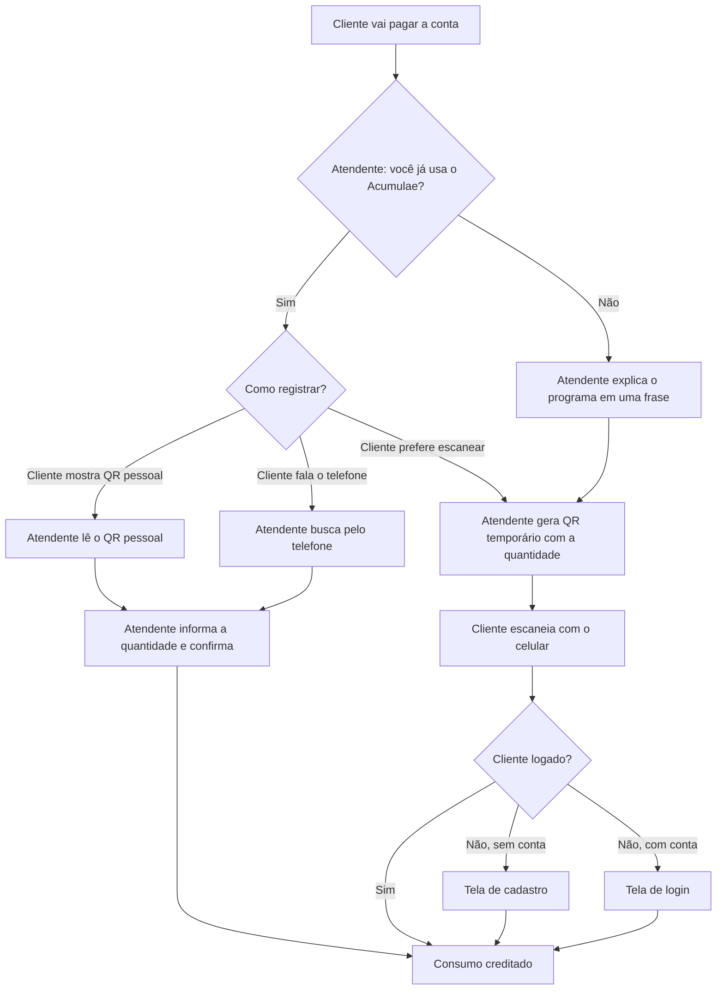

# Especificação do MVP — Plataforma de Fidelidade para Food Service

> **Nome do produto:** **Acumulae**
> **Status:** rascunho para desenvolvimento · v0.1 · nov/2026
> **Público-alvo inicial:** restaurantes com rodízio (sushi, pizza, churrasco), lojas de sobremesa e redes de franquia de alimentação.

Este documento descreve as regras de negócio, os fluxos e o modelo de dados do MVP. As marcações abaixo indicam a origem de cada item:

- **[DECIDIDO]**: definido pelo dono do produto.
- **[RECOMENDADO]**: sugestão técnica ainda não validada; pode ser alterada.
- **[EM ABERTO]**: precisa de decisão antes de implementar a parte afetada (ver seção 13).

---

## 1. Visão geral

### 1.1 Problema
Hoje a fidelidade nesses estabelecimentos usa um cartão de papel ("a cada 10 rodízios, ganhe 1"). O cartão fica com o cliente e costuma se perder, e com ele o progresso acumulado. O restaurante também não tem dados sobre quem são seus clientes frequentes.

### 1.2 Solução
Uma plataforma SaaS multi-tenant em que:

- o **cliente** tem **uma única conta na plataforma**, que vale em todos os estabelecimentos participantes, e acompanha num só lugar o progresso em cada um;
- cada **estabelecimento** tem o **próprio programa de fidelidade** (carteira individual por estabelecimento, não universal), com regras próprias, e vê apenas os seus clientes;
- o registro de consumo no caixa leva poucos segundos e funciona **nos dois sentidos**: o restaurante lê o QR do cliente, ou o cliente lê um QR temporário do restaurante.

### 1.3 Princípios do produto
1. **Zero atrito no caixa.** Registrar um consumo deve levar menos de 5 segundos.
2. **Sem app de loja no MVP.** O cliente usa uma PWA (site instalável). **[RECOMENDADO]**
3. **O cliente nunca perde o progresso.** Tudo fica na conta, nada em papel.
4. **Dados isolados por estabelecimento.** Um restaurante nunca vê a relação do cliente com outro.
5. **Tudo auditável.** O saldo é sempre derivado de um ledger de movimentações.

---

## 2. Glossário

| Termo | Definição |
|---|---|
| **Plataforma** | O SaaS **Acumulae** como um todo. |
| **Tenant / Estabelecimento** | Cliente pagante do SaaS (um restaurante ou uma rede). Dono do programa de fidelidade. |
| **Unidade (Store)** | Ponto físico de um tenant. Um tenant tem 1..N unidades. |
| **Cliente** | Pessoa física consumidora, com conta global na plataforma. |
| **Vínculo (Membership)** | Relação entre um cliente e um tenant. É a "carteira" do cliente naquele estabelecimento. |
| **Programa de fidelidade** | Regras de um tenant: meta, recompensa, validade e restrições. |
| **Consumo / Selo** | Unidade acumulada (ex.: 1 rodízio = 1 selo). |
| **Meta** | Quantidade de selos para liberar uma recompensa (padrão: 10). |
| **Recompensa** | Benefício liberado ao atingir a meta (ex.: "1 rodízio grátis"). |
| **Resgate** | Uso presencial de uma recompensa disponível. |
| **Ledger** | Histórico imutável de movimentações (créditos, estornos, resgates, expirações). |
| **QR pessoal** | QR Code exibido no app do cliente que o identifica no caixa. |
| **QR temporário (Checkout Token)** | QR gerado pelo atendente para um consumo específico, que o cliente escaneia. |
| **Atendente** | Funcionário do tenant que opera o caixa. |
| **Gestor** | Dono ou gerente do tenant, com acesso administrativo ao painel. |

---

## 3. Perfis de acesso

| Perfil | Onde acessa | Pode |
|---|---|---|
| **Cliente** | PWA do cliente | Criar a própria conta, ver estabelecimentos e progresso, mostrar o QR pessoal, escanear o QR temporário, ver histórico, gerenciar consentimentos e excluir a conta. |
| **Atendente** | Tela de caixa (web, celular ou tablet) | Buscar cliente (QR pessoal ou telefone), lançar consumo, gerar QR temporário, realizar resgate. |
| **Gestor** | Painel do estabelecimento (web) | Tudo do atendente, mais: configurar o programa, gerenciar unidades e funcionários, ver clientes, histórico e relatórios, estornar movimentações. |
| **Admin da plataforma** | API administrativa (MVP); backoffice interno (futuro) | Cadastrar e suspender estabelecimentos, unidades e o primeiro gestor; suporte (ex.: corrigir telefone, mesclar contas). |

**[DECIDIDO]** O atendente **não cadastra clientes**. A conta é sempre criada pelo próprio cliente.

**[DECIDIDO]** No MVP **não existe cadastro self-service de estabelecimentos**. O admin da plataforma cadastra cada estabelecimento por script, chamando um endpoint HTTP da API administrativa (seção 5.10). O cadastro aberto, com pagamento por gateway, entra depois da validação com os pilotos (Fase 3).

---

## 4. Escopo do MVP

### 4.1 Dentro do MVP

> **[DECIDIDO]** No MVP, o cliente usa **apenas o app (PWA) e QR Codes** para se identificar, acumular e acompanhar o progresso. Os cartões na Google Wallet e na Apple Wallet são uma **evolução da Fase 2** e não devem ser implementados agora. A única preparação é o modelo de dados do MVP não impedir essa evolução.

- Cadastro e login do cliente (e-mail/senha, Google e Apple).
- PWA do cliente: lista de estabelecimentos com progresso, QR pessoal, histórico.
- Tela de caixa: lançar consumo pelo QR pessoal ou pelo telefone, gerar QR temporário, resgatar.
- Painel do gestor: programa de fidelidade, funcionários, clientes, movimentações e indicadores básicos.
- Multi-tenant com unidades.
- Ledger, estorno e auditoria.
- API administrativa da plataforma para cadastrar estabelecimentos, unidades e o primeiro gestor por script (seção 5.10).

### 4.2 Fora do MVP (fases futuras, ver seção 12)
- Cartão na Google Wallet / Apple Wallet.
- Campanhas e notificações (push na Wallet, WhatsApp, e-mail).
- Aniversariantes e clientes inativos (30/60/90 dias).
- Pontos por valor gasto (R$ 1 = 1 ponto).
- NFC.
- Integração com sistemas de PDV.
- Cadastro self-service de estabelecimentos, cobrança e assinatura dos planos (integração com gateway de pagamentos).
- Backoffice visual do admin da plataforma (no MVP, tudo via API/script).
- Painel consolidado de rede de franquias.

---

## 5. Regras de negócio

### 5.1 Conta do cliente

- **RN-01 [DECIDIDO]** O cliente tem **uma única conta global**, válida em todos os estabelecimentos.
- **RN-02 [DECIDIDO]** O cadastro é **sempre feito pelo próprio cliente**, no celular dele.
- **RN-03 [DECIDIDO]** Campos do cadastro com e-mail/senha:

  | Campo | Obrigatório | Observação |
  |---|---|---|
  | Nome | Sim | Exibido para o atendente no caixa e no resgate. |
  | Telefone (WhatsApp) | Sim | **Único** na plataforma. Usado na busca do caixa e no login. |
  | E-mail | Sim | **Único** na plataforma. Usado no login e na recuperação de senha. |
  | Senha | Sim | Ver RN-08. |
  | Data de nascimento | **Não** | Usada pelos estabelecimentos em promoções de aniversário. |

- **RN-04 [DECIDIDO]** O telefone **não é verificado** no MVP (sem código por SMS/WhatsApp).
- **RN-05 [RECOMENDADO]** Antes de salvar, exibir confirmação: "Seu WhatsApp é (47) 9 9999-9999 e seu e-mail é maria@gmail.com?". Um erro de digitação impede a recuperação da conta.
- **RN-06 [RECOMENDADO]** O campo de nascimento deve explicar o benefício: "Informe e ganhe um presente no seu aniversário".
- **RN-07 [DECIDIDO]** Login com **Google** e **Apple**, além de e-mail/senha. No login social, nome e e-mail vêm do provedor, e o cliente completa **telefone** (obrigatório) e **nascimento** (opcional) numa única tela, uma vez.
  - **[RECOMENDADO]** O login com Apple exige o Apple Developer Program (US$ 99/ano). Pode ficar atrás de uma *feature flag* até a assinatura ser feita.

### 5.2 Autenticação e sessão

- **RN-08 [RECOMENDADO]** Regras de senha: no mínimo 6 caracteres; bloquear sequências óbvias (`123456`, `abcdef`), a data de nascimento e o telefone.
- **RN-09 [DECIDIDO]** Login com **telefone ou e-mail**, mais a senha.
- **RN-10 [RECOMENDADO]** Sessão de longa duração no aparelho: refresh token rotativo, válido por 180 dias e renovado a cada uso. No mesmo aparelho o cliente não precisa logar de novo.
- **RN-11 [RECOMENDADO]** A senha só é pedida em aparelho novo, depois de limpar o navegador, com a sessão expirada ou após logout.
- **RN-12 [RECOMENDADO]** Recuperação de senha **por e-mail** (link de uso único, válido por 30 minutos).
- **RN-13 [RECOMENDADO]** Limite de tentativas: 5 erros de login em 15 minutos bloqueiam o login por 15 minutos para aquele identificador e IP.
- **RN-14 [RECOMENDADO]** Se alguém tentar cadastrar um telefone ou e-mail **já existente**, o sistema não cria conta nova: informa que a conta já existe e oferece "Entrar" ou "Esqueci minha senha".
- **RN-15 [RECOMENDADO]** Vinculação de login social a uma conta existente com o mesmo e-mail é automática **somente** se o provedor garantir o e-mail verificado (`email_verified = true`). Caso contrário, o cliente precisa logar com a senha antes de vincular.

### 5.3 Estabelecimento, unidades e programa

- **RN-20 [DECIDIDO]** Cada tenant tem **o próprio programa de fidelidade**. Saldos de tenants diferentes nunca se misturam.
- **RN-21 [RECOMENDADO]** Um tenant tem 1..N unidades. Todo consumo e todo resgate registram a unidade onde aconteceram.
- **RN-22 [EM ABERTO]** Numa rede com várias unidades, o selo vale em **qualquer unidade da rede** ou **só na unidade onde foi ganho**? Ver Q-01. O modelo de dados deve suportar as duas opções; o MVP pode começar com "vale na rede inteira".
- **RN-23 [DECIDIDO]** Configuração do programa pelo gestor:

  | Configuração | Padrão | Observação |
  |---|---|---|
  | Meta de selos | 10 | Inteiro de 2 a 50. |
  | Descrição da recompensa | — | Ex.: "1 rodízio grátis". |
  | Nome da unidade de consumo | "selo" | Ex.: "rodízio", "sobremesa". Usado nos textos. |
  | Validade dos selos | Sem validade | [RECOMENDADO] Opcional, em dias desde cada crédito. |
  | Restrição de resgate | Nenhuma | [RECOMENDADO] Ex.: só de segunda a quinta. |
  | Máximo de selos por lançamento | 20 | [RECOMENDADO] Antifraude. |

- **RN-24 [DECIDIDO]** O estabelecimento pode ter vários programas (aba **Programas** do painel: criar, editar, ativar, desativar e excluir os que nunca tiveram clientes). O número de programas **ativos ao mesmo tempo** é limitado pelo **plano de contratação** (tabela `plans`, campo `max_active_programs`; no plano PILOTO, 1). O cliente tem um cartão por programa. Alterar a meta não afeta recompensas já liberadas; programa desativado não aceita lançamentos, mas as recompensas já liberadas continuam resgatáveis.

### 5.4 Consumo (crédito de selos)

- **RN-30 [DECIDIDO]** O caixa **só lança consumo para quem já tem conta**.
- **RN-31 [DECIDIDO]** O registro funciona em dois sentidos:
  - **A. Restaurante → Cliente:** o atendente lê o **QR pessoal** do cliente, ou busca pelo **telefone**, e lança a quantidade.
  - **B. Cliente → Restaurante:** o atendente gera um **QR temporário** com a quantidade e o cliente escaneia com o celular logado.
- **RN-32 [RECOMENDADO]** Quantidade é um inteiro ≥ 1 e ≤ o máximo por lançamento (RN-23).
- **RN-33 [EM ABERTO]** No rodízio, numa mesa com várias pessoas: cada pessoa recebe no próprio cadastro, ou o pagador recebe N selos? Ver Q-02. O sistema permite as duas coisas (a quantidade é livre); a dúvida é qual regra o produto incentiva e exibe.
- **RN-34 [DECIDIDO]** O **vínculo** cliente ↔ tenant é criado automaticamente no **primeiro consumo** do cliente naquele tenant.
- **RN-35 [RECOMENDADO]** Ao criar o vínculo, o cliente é perguntado (no app dele, não no caixa) se aceita receber promoções daquele estabelecimento. O consentimento é **por tenant** (ver seção 10).
- **RN-36 [RECOMENDADO]** Todo lançamento registra: tenant, unidade, funcionário, cliente, quantidade, origem (`QR_PESSOAL`, `TELEFONE` ou `QR_TEMPORARIO`), data e hora, e uma **chave de idempotência**.
- **RN-37 [DECIDIDO]** Configurável por programa ("Guardar o excedente para o próximo cartão"). Ligado: o excedente é carregado (meta 10, saldo 9, crédito de 3 → 1 recompensa e saldo 2). Desligado: o cartão recomeça do zero e o excedente é registrado como `EXCEDENTE_DESCARTADO` (devolvido se o crédito for estornado); o caixa avisa antes de lançar.
- **RN-38 [RECOMENDADO]** Ao atingir a meta, a recompensa fica **disponível** imediatamente e o cliente vê isso no app.

### 5.5 QR temporário (Checkout Token)

- **RN-40 [DECIDIDO]** Gerado pelo atendente para **um consumo específico**, já com a quantidade.
- **RN-41 [RECOMENDADO]** É de **uso único** e **expira em 10 minutos**. Os 10 minutos dão tempo para um cliente novo se cadastrar.
- **RN-42 [RECOMENDADO]** Fica vinculado a tenant, unidade e funcionário que o gerou.
- **RN-43 [RECOMENDADO]** O QR contém só um token opaco e aleatório (ex.: 128 bits em base62) numa URL, como `https://{{dominio}}/c/{token}`. Nenhum dado de negócio vai no QR.
- **RN-44 [DECIDIDO]** Comportamento ao escanear:
  - cliente **logado** → crédito imediato e tela de confirmação ("+2 rodízios no Sushi X. Você tem 7/10");
  - cliente **não logado e sem conta** → tela de cadastro, com crédito automático ao concluir;
  - cliente **não logado, mas com conta** → tela de login, com crédito automático ao concluir.
- **RN-45 [RECOMENDADO]** A tela do caixa acompanha o token (polling ou SSE) e mostra "Creditado para Maria S." quando ele for usado.
- **RN-46 [RECOMENDADO]** O atendente pode cancelar um QR temporário ainda não usado.

### 5.6 QR pessoal do cliente

- **RN-50 [DECIDIDO]** O cliente tem um QR pessoal no app que o identifica em qualquer estabelecimento.
- **RN-51 [RECOMENDADO]** O QR pessoal é **dinâmico**: rotaciona a cada 30 segundos (estilo TOTP, assinado pelo servidor). Um print ou foto do QR não serve para resgatar a recompensa de outra pessoa.
- **RN-52 [DECIDIDO]** Como alternativa ao QR, o atendente busca o cliente **pelo telefone**. A busca por telefone permite lançar consumo **e usar recompensas** (ver RN-61).

### 5.7 Resgate

- **RN-60 [DECIDIDO]** O resgate é **presencial**, no estabelecimento.
- **RN-61 [DECIDIDO]** O resgate é feito com o cliente identificado no caixa, **pelo QR pessoal ou pelo telefone**. O atendente toca em "Utilizar recompensa disponível", escolhe quantas recompensas o cliente vai usar e confirma. Na busca por telefone, o atendente confere o nome do cliente antes de entregar.
- **RN-62 [RECOMENDADO]** Antes de confirmar, o atendente vê o nome do cliente, a recompensa e as restrições, e confirma.
- **RN-63 [DECIDIDO]** Após o resgate, o ciclo **reinicia**: a recompensa vira "resgatada" e o progresso segue a partir do excedente (RN-37).
- **RN-64 [RECOMENDADO]** O resgate respeita as restrições configuradas (ex.: dia da semana). Se estiver bloqueado, a tela explica o motivo.
- **RN-65 [RECOMENDADO]** Se a recompensa tiver validade e expirar, o sistema lança uma movimentação `EXPIRACAO`.

### 5.8 Estorno e auditoria

- **RN-70 [RECOMENDADO]** Somente o **gestor** pode estornar um lançamento ou resgate. O estorno exige motivo.
- **RN-71 [RECOMENDADO]** Estorno nunca apaga: cria uma movimentação de sentido contrário que referencia a original.
- **RN-72 [RECOMENDADO]** O saldo é **sempre derivado do ledger**. Pode haver uma tabela/campo de saldo em cache, mas ela é reconstruível a partir das movimentações.
- **RN-73 [RECOMENDADO]** O painel mostra para cada movimentação: quem recebeu, quanto, quando, em qual unidade e qual funcionário lançou.

### 5.9 Visibilidade e isolamento

- **RN-80 [DECIDIDO]** O **estabelecimento** vê todos os clientes que acumulam consumo nele.
- **RN-81 [DECIDIDO]** O **cliente** vê todos os estabelecimentos onde já consumiu e quanto falta para cada recompensa.
- **RN-82 [RECOMENDADO]** Um estabelecimento **nunca** vê que o cliente tem vínculo com outro estabelecimento, nem dados de outros vínculos. Isso é validado **no backend**, em toda consulta.
- **RN-83 [EM ABERTO]** O app do cliente mostra **apenas** os estabelecimentos onde ele já consumiu, ou também **sugere** outros participantes? Ver Q-03. Recomendação para o MVP: apenas os já frequentados.

### 5.10 Cadastro de estabelecimentos (admin da plataforma)

- **RN-90 [DECIDIDO]** No MVP, estabelecimentos são cadastrados **somente pelo admin da plataforma**, via script que chama a API administrativa por HTTP.
- **RN-91 [RECOMENDADO]** A API administrativa fica sob o prefixo `/api/platform/**` e é autenticada por uma **chave de API da plataforma** enviada no header `X-Platform-Key`.
  - A chave vem de variável de ambiente (nunca no código nem no repositório) e é comparada em tempo constante.
  - Esses endpoints não aceitam sessão de cliente nem de funcionário.
  - Opcional: restringir por IP de origem e aplicar rate limit.
- **RN-92 [RECOMENDADO]** Uma única chamada cria, numa transação: o **tenant**, a **primeira unidade**, o **programa de fidelidade** (com os padrões da RN-23, sobrescrevíveis no corpo) e o **primeiro gestor**.
- **RN-93 [RECOMENDADO]** O gestor **não recebe senha definida pelo script**. A API gera um **link de convite** de uso único, válido por 72 horas, que é devolvido na resposta e pode ser enviado por e-mail. Pelo link, o gestor define a própria senha.
- **RN-94 [RECOMENDADO]** A chamada é **idempotente pelo `slug`**: reenviar o mesmo cadastro não duplica o tenant e devolve `409 Conflict` com o ID existente.
- **RN-95 [RECOMENDADO]** O admin também pode, via API: adicionar unidades, reenviar o convite do gestor, alterar o plano e **suspender/reativar** um tenant. Tenant suspenso: o caixa e o painel ficam bloqueados, e os clientes continuam vendo o progresso no app, mas não acumulam nem resgatam.
- **RN-96 [RECOMENDADO]** Toda chamada da API administrativa é registrada num log de auditoria (`platform_audit_log`).
- **RN-97 [DECIDIDO]** Depois da validação com os pilotos, o cadastro de empresas é aberto em modo self-service, mediante pagamento, com integração a um gateway (Fase 3). A API administrativa continua existindo para suporte e para cadastros manuais.

Exemplo de chamada:

```http
POST /api/platform/tenants
X-Platform-Key: {{PLATFORM_API_KEY}}
Content-Type: application/json

{
  "name": "Sushi X",
  "slug": "sushi-x",
  "plan": "PILOTO",
  "branding": { "logoUrl": "https://...", "primaryColor": "#D62828" },
  "store": { "name": "Sushi X - Centro", "slug": "centro", "address": "Rua ..., Joinville/SC" },
  "program": { "unitLabel": "rodízio", "goal": 10, "rewardDescription": "1 rodízio grátis" },
  "manager": { "name": "Fulano", "email": "dono@sushix.com.br" }
}
```

Resposta `201 Created`:

```json
{
  "tenantId": "…",
  "storeId": "…",
  "programId": "…",
  "managerInviteUrl": "https://{{dominio}}/painel/convite/{token}",
  "managerInviteExpiresAt": "2026-11-21T17:00:00Z",
  "storeSignupQrUrl": "https://{{dominio}}/e/sushi-x"
}
```

### 5.11 Personalização visual dos cartões

- **RN-100 [DECIDIDO]** A plataforma será **bem personalizável** por estabelecimento: cores, logo, fundo do cartão, selo personalizado e afins, para o cartão ficar bonito no app do cliente e na carteira do celular. A personalização completa entra na **Fase 2**.
- **RN-101 [DECIDIDO]** **Já no MVP**, o modelo de dados guarda a identidade visual numa tabela própria (`tenant_branding`, seção 8.1), e o app do cliente usa pelo menos **logo + cor principal** de cada estabelecimento. O logo é **enviado pelo gestor** (PNG/JPG/WebP, reduzido para 256 px, até 200 KB) e guardado no próprio banco; não há URL externa. Assim a Fase 2 só acrescenta campos e telas, sem refatorar. Também já no MVP: **cor secundária** opcional e **modelo do cartão** escolhido pelo gestor (Clássico, Degradê ou Moldura); ver `docs/decisoes.md`.
- **RN-102 [RECOMENDADO]** Itens personalizáveis na Fase 2:

  | Item | No app do cliente (PWA) | Na Google Wallet | Na Apple Wallet |
  |---|---|---|---|
  | Logo | Livre | Logo do programa | Logo e ícone |
  | Cor de fundo do cartão | Livre | Cor de fundo do passe | Cor de fundo do passe |
  | Cor do texto | Livre | Definida pela Wallet | Cores do texto e dos rótulos |
  | Imagem de fundo / capa | Livre | Imagem de destaque (*hero image*) | Imagem de faixa (*strip image*) |
  | Selo personalizado (ícone do selo cheio/vazio) | Livre | Desenhado dentro da imagem de destaque | Desenhado dentro da imagem de faixa |
  | Fonte | Lista de fontes pré-aprovadas | Não personalizável | Não personalizável |

- **RN-103 [RECOMENDADO] (Fase 2, não implementar no MVP)** Nas carteiras do Google e da Apple, a **posição** das áreas do cartão é fixa, mas o **conteúdo** é atualizado remotamente a qualquer momento via API: textos (saldo, recompensa, mensagens), cores, logo, imagem e QR. Só a **grade visual de selos** não existe nativamente. Duas formas de mostrar o progresso:
  1. **[DECIDIDO] Texto, na primeira versão dos cartões na Wallet:** campo de saldo "7/10 rodízios" e campo "Próxima recompensa: 1 rodízio grátis", atualizados remotamente a cada crédito, resgate ou estorno.
  2. **[RECOMENDADO] Imagem de selos, opcional e posterior:** o servidor gera a imagem (fundo + selos cheios/vazios) e a usa como imagem de destaque/faixa. A imagem depende só de `(tenant, versão do branding, quantidade)`, então cada programa tem no máximo `meta + 1` imagens (ex.: 11 para meta 10), geradas uma vez e reaproveitadas para todos os clientes.
- **RN-104 [RECOMENDADO]** **Temas prontos** para quem não tem designer: o gestor escolhe um modelo (ex.: "Sushi", "Doceria", "Hamburgueria") e só troca logo e cores.
- **RN-105 [RECOMENDADO]** **Pré-visualização** no painel: o gestor vê como o cartão fica no app, na Google Wallet e na Apple Wallet antes de publicar.
- **RN-106 [RECOMENDADO]** **Validação de contraste** entre a cor de fundo e a cor do texto (WCAG AA, 4,5:1). O painel avisa ou bloqueia combinações ilegíveis.
- **RN-107 [RECOMENDADO]** Regras de upload: PNG/JPG/SVG (SVG é convertido no servidor), tamanho máximo de 2 MB, dimensões mínimas por tipo de imagem, recorte e redimensionamento automáticos para cada formato exigido pelas carteiras. Os arquivos ficam num storage de objetos (compatível com S3), servidos por CDN.
- **RN-108 [RECOMENDADO]** Alterar a identidade visual **atualiza todos os cartões já emitidos**: na PWA na hora; nas carteiras via atualização remota dos passes, em lote e em segundo plano.

---

## 6. Fluxos

### 6.1 Cadastro pelo QR do balcão (sem estar pagando)

1. O cliente escaneia o QR fixo do balcão (`https://{{dominio}}/e/{slug-do-estabelecimento}`).
2. Abre a página do estabelecimento: "Participe do programa do Sushi X: a cada 10 rodízios, ganhe 1".
3. O cliente escolhe **Continuar com Google**, **Continuar com Apple** ou **Cadastrar com e-mail**.
4. Preenche os dados que faltam (RN-03 / RN-07) e confirma telefone e e-mail (RN-05).
5. Fica logado (RN-10) e vê o estabelecimento com 0/10. O vínculo pode ser criado aqui ou no primeiro consumo; ver Q-04.

### 6.2 Fluxo no caixa — visão geral



### 6.3 Fluxo A — atendente lê o QR pessoal

1. O cliente abre o app e toca em **Meu QR**. O QR rotaciona a cada 30 segundos.
2. O atendente toca em **Ler cliente** na tela do caixa e aponta a câmera.
3. O caixa mostra: nome do cliente, progresso neste estabelecimento (ou "primeira visita") e recompensas disponíveis.
4. O atendente informa a quantidade (padrão 1) e toca em **Lançar**.
5. O cliente vê o progresso atualizado no app.

### 6.4 Fluxo A' — atendente busca pelo telefone

1. O atendente digita o telefone.
2. O caixa mostra o **nome parcialmente mascarado** para conferência (ex.: "Maria S****"). [RECOMENDADO]
3. O atendente confirma com o cliente, informa a quantidade e lança.
4. Se não houver conta com esse telefone, o caixa orienta a usar o QR temporário (o cliente se cadastra na hora).

### 6.5 Fluxo B — QR temporário

1. O atendente toca em **Gerar QR**, informa a quantidade (ex.: 2 rodízios) e confirma.
2. O caixa exibe o QR e um contador de expiração (10 minutos).
3. O cliente escaneia com a câmera do celular.
4. O comportamento segue a RN-44 (logado, sem conta ou com conta).
5. Ao usar o token, o caixa mostra "Creditado para Maria S." (RN-45) e o QR some.
6. Se expirar ou for cancelado, o token fica inválido. Escanear depois mostra "Este código expirou, peça um novo ao atendente".

### 6.6 Resgate

1. O atendente identifica o cliente pelo **QR pessoal** ou pelo **telefone** (RN-61).
2. O caixa mostra a recompensa disponível ("1 rodízio grátis") e as restrições.
3. O atendente toca em **Utilizar recompensa disponível**, escolhe a quantidade e confirma.
4. O sistema lança `RESGATE`, a recompensa vira "resgatada" e o progresso reinicia (RN-63).
5. O cliente vê no app "Recompensa resgatada em 18/11 no Sushi X".

### 6.7 Recuperação de senha

1. O cliente toca em **Esqueci minha senha** e informa e-mail ou telefone.
2. O sistema envia um link de uso único para o **e-mail cadastrado**. A tela não revela se a conta existe: "Se houver uma conta, enviamos um link".
3. O cliente define a nova senha; todas as sessões antigas são encerradas. [RECOMENDADO]

### 6.8 Exclusão de conta (LGPD)

1. O cliente toca em **Excluir minha conta** e confirma com a senha (ou login social).
2. Os dados pessoais são anonimizados. As movimentações do ledger permanecem para a auditoria dos estabelecimentos, mas sem identificar a pessoa. [RECOMENDADO]

---

## 7. Telas

### 7.1 PWA do cliente
- **Entrada:** Google / Apple / e-mail; cadastro; login; esqueci a senha.
- **Início:** lista de estabelecimentos em formato de **cartões**, cada um com o logo e a cor principal do estabelecimento (RN-101), progresso `7/10`, barra de progresso e selo "Recompensa disponível" quando houver. Na Fase 2, os cartões ganham fundo, selos e demais itens personalizados (seção 5.11).
- **Detalhe do estabelecimento:** regras, progresso, recompensas disponíveis e resgatadas, histórico.
- **Meu QR:** QR pessoal dinâmico em tela cheia, com brilho alto.
- **Conta:** dados, consentimentos por estabelecimento, trocar senha, sair, excluir conta.
- **Leitura de QR temporário:** acontece pela câmera nativa do celular (o QR é uma URL), então não precisa de leitor dentro do app.

### 7.2 Tela de caixa (atendente)
- Botões grandes: **Ler cliente**, **Buscar por telefone**, **Gerar QR**.
- Resultado da leitura: nome, progresso, recompensas, campo de quantidade, **Lançar** e **Resgatar**.
- Últimos lançamentos da unidade (para conferência rápida).
- Seleção da unidade ao entrar, para funcionários de mais de uma unidade.

### 7.3 Painel do gestor
- **Indicadores:** clientes vinculados, consumos no mês, recompensas liberadas e resgatadas.
- **Clientes:** lista com nome, telefone (se houver consentimento), saldo, último consumo e total de visitas; detalhe com histórico.
- **Movimentações:** filtro por período, unidade, funcionário e tipo; estorno.
- **Programa:** configurações da RN-23.
- **Unidades:** cadastro, com QR do balcão de cada unidade para imprimir.
- **Funcionários:** convite por e-mail, perfil (atendente ou gestor), unidades permitidas, ativar e desativar.

---

## 8. Modelo de dados

Convenções [RECOMENDADO]: PostgreSQL; IDs em UUID; `created_at`/`updated_at` em UTC (exibição em `America/Sao_Paulo`); toda tabela de domínio do estabelecimento tem `tenant_id`.

### 8.1 Plataforma e estabelecimento

```text
tenants
  id, name, slug (único), status (ACTIVE|SUSPENDED), plan, created_at
  -- logo e cores ficam em tenant_branding

stores                      -- unidades
  id, tenant_id → tenants, name, slug, address, status, created_at

staff_users                 -- atendentes e gestores
  id, name, email (único), password_hash, status, created_at

staff_memberships           -- perfil do funcionário em cada tenant
  id, staff_user_id → staff_users, tenant_id → tenants,
  role (MANAGER|ATTENDANT), created_at

staff_store_access          -- unidades permitidas para o funcionário
  staff_membership_id → staff_memberships, store_id → stores

tenant_branding             -- identidade visual (MVP: logo, cores e modelo do cartão; Fase 2: o resto)
  tenant_id (PK) → tenants,
  logo_url, primary_color,                          -- MVP
  secondary_color (null = usa a principal),         -- MVP
  card_style (CLASSICO | DEGRADE | MOLDURA),        -- MVP
  background_color, text_color, label_color,        -- Fase 2
  cover_image_url, stamp_filled_url, stamp_empty_url,
  font_key, theme_key,
  version (int, incrementa a cada publicação),     -- invalida cache de imagens e dispara atualização dos passes
  updated_at

staff_invites               -- convite do gestor/funcionário para definir senha
  id, tenant_id, email, role, token_hash, expires_at, used_at, created_at

platform_audit_log          -- chamadas da API administrativa
  id, action, target_type, target_id, payload_summary, source_ip, created_at
```

### 8.2 Cliente e autenticação

```text
customers                   -- conta GLOBAL, não pertence a nenhum tenant
  id, name, phone_e164 (único), email (único, lowercase),
  birth_date (nullable), password_hash (nullable p/ só-login-social),
  status (ACTIVE|DELETED), created_at, deleted_at

customer_identities         -- logins sociais
  id, customer_id → customers, provider (GOOGLE|APPLE),
  provider_subject (o "sub" do provedor), email_at_provider,
  UNIQUE(provider, provider_subject)

customer_sessions           -- refresh tokens
  id, customer_id, refresh_token_hash, device_label,
  expires_at, last_used_at, revoked_at

password_reset_tokens
  id, customer_id, token_hash, expires_at, used_at
```

> Identifique o login social pelo `provider_subject`, **nunca** pelo e-mail. No login com Apple o e-mail pode ser um endereço `@privaterelay.appleid.com`, e o **nome só vem na primeira autorização**: salve nesse momento.

### 8.3 Fidelidade

```text
loyalty_programs
  id, tenant_id, unit_label ("rodízio"), goal (10),
  reward_description, stamp_validity_days (nullable),
  redeem_weekdays (nullable, ex.: {1,2,3,4}), max_per_entry (20),
  scope (TENANT|STORE)   -- ver Q-01
  active, created_at

memberships                 -- o "cartão" do cliente no estabelecimento
  id, tenant_id, customer_id, program_id,
  marketing_consent (bool), marketing_consent_at,
  first_visit_at, last_visit_at,
  cached_balance, cached_rewards_available,   -- cache derivado do ledger
  UNIQUE(tenant_id, customer_id)

ledger_entries              -- IMUTÁVEL
  id, tenant_id, store_id, membership_id,
  type (CREDITO|ESTORNO_CREDITO|RECOMPENSA_LIBERADA|RESGATE|ESTORNO_RESGATE|EXPIRACAO),
  quantity (int, com sinal),
  source (QR_PESSOAL|TELEFONE|QR_TEMPORARIO|SISTEMA),
  staff_user_id (nullable p/ SISTEMA),
  checkout_token_id (nullable),
  reverses_entry_id (nullable),
  reason (nullable),
  idempotency_key (UNIQUE por tenant),
  created_at

rewards                     -- recompensas liberadas
  id, tenant_id, membership_id, program_id, description,
  status (DISPONIVEL|RESGATADA|EXPIRADA|ESTORNADA),
  unlocked_entry_id, redeemed_entry_id (nullable),
  expires_at (nullable), created_at

checkout_tokens             -- QR temporário
  id, tenant_id, store_id, staff_user_id,
  token_hash, quantity, expires_at,
  used_at (nullable), used_by_customer_id (nullable),
  cancelled_at (nullable), created_at
```

### 8.4 Regras de integridade
- Toda consulta e escrita do painel e do caixa filtra por `tenant_id` do funcionário autenticado. [RECOMENDADO: um filtro central no repositório ou via Row-Level Security do PostgreSQL.]
- Usar o `checkout_token` deve ser atômico (`UPDATE ... SET used_at = now() WHERE id = ? AND used_at IS NULL AND cancelled_at IS NULL AND expires_at > now()`), para que dois escaneamentos simultâneos não gerem dois créditos.
- O crédito e a liberação de recompensa acontecem na **mesma transação**.
- `cached_balance` é atualizado na mesma transação do lançamento. Um job de reconciliação pode recalcular a partir do ledger.

---

## 9. Segurança e antifraude

| Risco | Mitigação |
|---|---|
| Cliente ganha selo sem consumir | Todo crédito parte do atendente: lançamento manual ou QR temporário gerado por ele. Não há QR estático que credite. |
| QR temporário fotografado e usado depois | Uso único + expiração de 10 minutos + uso atômico. |
| Alguém resgata a recompensa de outra pessoa | O atendente confirma o nome do cliente antes de entregar (a busca por telefone mostra o nome parcialmente mascarado); todo resgate registra funcionário e origem, e o gestor pode estorná-lo. O QR pessoal dinâmico continua sendo a forma mais segura. |
| Funcionário lança selos indevidos | Registro do funcionário em cada lançamento, limite por lançamento, relatório por funcionário, estorno pelo gestor. |
| Lançamento duplicado (clique duplo, rede instável) | Chave de idempotência no lançamento. |
| Acesso à conta por quem sabe telefone e nascimento | Login exige senha ou login social. Nascimento e telefone nunca servem de credencial. |
| Força bruta na senha | Limite de tentativas (RN-13), hash forte (BCrypt/Argon2). |
| Estabelecimento vê dados de concorrentes | Isolamento por tenant no backend (RN-82). |
| Telefone de outra pessoa cadastrado | O dono real usa a recuperação de senha por e-mail; o suporte da plataforma pode corrigir o telefone. [RECOMENDADO] Fase futura: verificação por código no WhatsApp. |

---

## 10. Privacidade (LGPD)

- **[RECOMENDADO]** No cadastro, aceite dos Termos de Uso e da Política de Privacidade, explicando que:
  - a conta é da plataforma;
  - cada estabelecimento onde o cliente consome passa a ver nome, histórico de consumo naquele estabelecimento e, com consentimento, telefone e data de nascimento.
- **[RECOMENDADO]** O consentimento de marketing é **separado** do cadastro e **por estabelecimento** (`memberships.marketing_consent`). Aceitar promoções do Sushi X não autoriza a Pizzaria Y.
- **[RECOMENDADO]** Sem consentimento de marketing, o painel do gestor mostra o telefone mascarado e não permite incluir o cliente em campanhas.
- **[RECOMENDADO]** O cliente pode revogar consentimentos e excluir a conta pelo app (fluxo 6.8).
- **[RECOMENDADO]** Não coletar CPF no MVP.

---

## 11. Arquitetura sugerida [RECOMENDADO]

| Camada | Tecnologia |
|---|---|
| Backend / API | Java + Spring Boot, Spring Security (OAuth2 Client para Google e Apple), Spring Data JPA, Flyway |
| Banco | PostgreSQL |
| Cache / rate limit | Redis (opcional no início; o rate limit pode começar em memória ou no banco) |
| Frontend | Next.js: PWA do cliente, tela de caixa e painel do gestor (pode ser um app só, com rotas separadas, ou três apps) |
| Leitura de QR no caixa | Biblioteca de câmera no navegador (ex.: `zxing-js` ou `html5-qrcode`) |
| E-mail transacional | Qualquer provedor SMTP/API (recuperação de senha) |
| Deploy | VPS com Docker Compose |

### 11.1 API — esboço dos endpoints principais

```text
# Cliente
POST   /api/auth/register                 cadastro e-mail/senha
POST   /api/auth/login                    login (telefone ou e-mail + senha)
POST   /api/auth/refresh                  renova a sessão
POST   /api/auth/logout
POST   /api/auth/password/forgot
POST   /api/auth/password/reset
GET    /api/auth/oauth2/{google|apple}    início do login social
POST   /api/me/complete-profile           telefone/nascimento após login social
GET    /api/me                            dados da conta
GET    /api/me/memberships                estabelecimentos + progresso
GET    /api/me/memberships/{id}           detalhe + histórico
GET    /api/me/qr                         payload do QR pessoal dinâmico
PATCH  /api/me/memberships/{id}/consent
DELETE /api/me
GET    /api/c/{token}                     info do QR temporário (estabelecimento, quantidade, validade)
POST   /api/c/{token}/claim               cliente logado usa o QR temporário

# Caixa (atendente)
POST   /api/pos/customers/resolve-qr      QR pessoal → cliente + vínculo
GET    /api/pos/customers?phone=          busca por telefone
POST   /api/pos/credits                   lança consumo (com Idempotency-Key)
POST   /api/pos/checkout-tokens           gera QR temporário
GET    /api/pos/checkout-tokens/{id}      status (aguardando / usado / expirado)
DELETE /api/pos/checkout-tokens/{id}      cancela
POST   /api/pos/redemptions               resgata (exige QR pessoal)

# Painel (gestor)
GET/PUT  /api/admin/program
GET/POST /api/admin/stores
GET/POST /api/admin/staff
GET      /api/admin/customers
GET      /api/admin/customers/{membershipId}
GET      /api/admin/ledger
POST     /api/admin/ledger/{entryId}/reverse
GET      /api/admin/dashboard
POST     /api/staff/invites/{token}/accept   gestor/funcionário define a senha pelo convite

# Plataforma (admin da plataforma, header X-Platform-Key) — usado por script no MVP
POST   /api/platform/tenants                  cria tenant + unidade + programa + convite do gestor
GET    /api/platform/tenants                  lista tenants
GET    /api/platform/tenants/{id}
PATCH  /api/platform/tenants/{id}             altera plano, nome, logo
POST   /api/platform/tenants/{id}/suspend
POST   /api/platform/tenants/{id}/reactivate
POST   /api/platform/tenants/{id}/stores      adiciona unidade
POST   /api/platform/tenants/{id}/invites     reenvia/gera convite de gestor
```

---

## 12. Fases

### Fase 1 — MVP (pilotos)
- Tudo da seção 4.1.
- Estabelecimentos cadastrados pelo admin da plataforma via script + API (RN-90).
- Pilotos: 1 loja de sobremesa da rede de franquias + 1 restaurante de rodízio (sushi).
- Kit de implantação: display de balcão com o QR de cadastro de cada unidade.
- Métrica de sucesso: tempo de lançamento no caixa abaixo de 5 segundos; % de clientes que voltam.

### Fase 2 — Retenção e identidade visual
- Cartão na **Google Wallet**, depois na **Apple Wallet** (junto com a assinatura do Apple Developer).
- Na Wallet, o progresso aparece em **texto** ("7/10 rodízios"), atualizado a cada movimentação (RN-103).
- **Personalização visual completa** (seção 5.11): cores, fundo, selo personalizado, temas prontos e pré-visualização. A imagem de selos gerada no servidor para as carteiras fica como melhoria opcional depois.
- Notificação de recompensa liberada.
- Aniversariantes.
- Clientes inativos há 30/60/90 dias, com campanha de retorno.
- Campanhas por push na Wallet e e-mail.

### Fase 3 — Escala
- Painel consolidado de rede de franquias.
- Pontos por valor gasto.
- WhatsApp (API oficial, cobrado por mensagem; sem envio ilimitado nos planos).
- **Cadastro self-service de estabelecimentos** com pagamento: página de planos, escolha do plano, checkout e assinatura recorrente via gateway de pagamentos. Webhooks do gateway ativam, suspendem ou reativam o tenant automaticamente, reaproveitando as mesmas regras da RN-95.
- Verificação de telefone por código.

### Fase 4 — Integrações
- NFC (tags dinâmicas, ex.: NTAG 424 DNA), para autoatendimento.
- Integração com sistemas de PDV.
- API pública para parceiros.

---

## 13. Decisões em aberto

| ID | Pergunta | Impacto | Sugestão |
|---|---|---|---|
| **Q-01** | Numa rede/franquia, o selo vale em qualquer unidade ou só na unidade onde foi ganho? | `loyalty_programs.scope`, cálculo do saldo | Começar com "vale na rede inteira" (`TENANT`). |
| **Q-02** | No rodízio em grupo, cada pessoa registra no próprio cadastro ou o pagador ganha N selos? | Texto de orientação no caixa, limite por lançamento | Incentivar "cada um no seu cadastro"; o limite por lançamento evita abuso. |
| **Q-03** | O app do cliente mostra só os estabelecimentos onde ele consumiu, ou também sugere outros? | Tela inicial, contrato com os estabelecimentos | Só os já frequentados no MVP. |
| **Q-04** | O vínculo é criado ao se cadastrar pelo QR do balcão (com 0/10) ou só no primeiro consumo? | `memberships`, contagem de clientes no painel | Criar no cadastro pelo balcão, pois mostra o programa logo de cara. |
| **Q-05** | Validade dos selos e restrições de resgate entram no MVP ou ficam para depois? | Jobs de expiração, validação no resgate | Deixar os campos no modelo e implementar só "dias da semana" no MVP. |
| **Q-06** | Domínio (nome do produto já decidido: **Acumulae**). | URLs dos QRs (`{{dominio}}`) | Verificar `acumulae.com.br` no Registro.br e a marca no INPI (classes 9 e 42). |
| **Q-07** | Planos e preços (hipóteses iniciais: Básico R$ 49,90, Profissional R$ 89,90, Premium R$ 149,90 por estabelecimento/mês). | Limites por plano | Validar com os pilotos antes de implementar cobrança. No MVP, `plan` é só um campo informativo (ex.: `PILOTO`). |
| **Q-08** | Qual gateway de pagamentos usar no cadastro self-service? | Integração de cobrança e webhooks (Fase 3) | Decidir na Fase 3. Priorizar assinatura recorrente com Pix e cartão e webhooks confiáveis. |

---

## 14. Critérios de aceite do MVP (resumo)

- [ ] Um cliente novo se cadastra pelo QR temporário e recebe o crédito no mesmo fluxo, em menos de 1 minuto.
- [ ] Um cliente logado escaneia o QR temporário e o crédito aparece na tela do caixa em até 2 segundos.
- [ ] O atendente lê o QR pessoal e lança consumo em menos de 5 segundos.
- [ ] Dois escaneamentos simultâneos do mesmo QR temporário geram um único crédito.
- [ ] Um QR temporário expirado ou cancelado não gera crédito.
- [ ] Um print do QR pessoal não identifica o cliente depois de 30 segundos.
- [ ] O resgate funciona pelo QR pessoal e pelo telefone, permitindo usar mais de uma recompensa disponível de uma vez.
- [ ] Um gestor do Tenant A não consegue ver, por nenhum endpoint, dados de vínculos do Tenant B.
- [ ] O saldo de todos os vínculos bate com a soma do ledger (teste de reconciliação).
- [ ] Ao atingir a meta, a recompensa é liberada e o excedente é carregado.
- [ ] Após o resgate, o progresso reinicia corretamente.
- [ ] O estorno gera movimentação reversa e atualiza o saldo; o lançamento original continua visível.
- [ ] Login com Google funciona e pede telefone na primeira vez.
- [ ] A recuperação de senha por e-mail funciona e encerra as sessões antigas.
- [ ] Um script cadastra um estabelecimento completo (tenant, unidade, programa e convite do gestor) com uma única chamada HTTP.
- [ ] Chamadas a `/api/platform/**` sem `X-Platform-Key` válida retornam `401`.
- [ ] Reenviar o cadastro com o mesmo `slug` não duplica o tenant.
- [ ] O gestor define a senha pelo link de convite; um link usado ou expirado não funciona mais.
- [ ] Um tenant suspenso não consegue lançar consumo nem resgatar.
